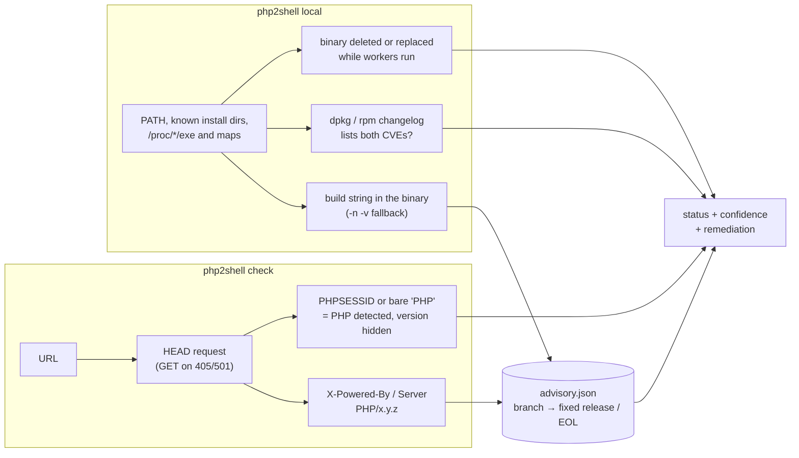

<h1 align="center">php2shell</h1>

<p align="center">
  <b>Check websites and servers for PHP2Shell (CVE-2026-109618, CVE-2026-109619), make sure the fix is actually running, and look for signs of compromise.</b><br>
  A single static binary for Linux, macOS, Windows and FreeBSD. No PHP, Node or Python needed.
</p>

<p align="center">
  <a href="https://github.com/0xgitpushpray/php2shell/actions/workflows/ci.yml"></a>
  <a href="https://github.com/0xgitpushpray/php2shell/releases/latest"></a>
  <a href="LICENSE"></a>
</p>

---

**PHP2Shell** is a pair of critical remote code execution bugs in the PHP engine (CVSS 4.0: 9.2).
An unauthenticated attacker can exploit them on any PHP installation that serves web requests:
php-fpm, Apache with mod_php, php-cgi, LiteSpeed and FrankenPHP. PHP fixed them on
**2026-10-21** in **8.5.12, 8.4.27, 8.3.36 and 8.2.35**. Attacks were seen from **2026-10-17**,
four days before the fix was published.

`php2shell` answers the three questions that matter after a disclosure like this:

1. **Is it vulnerable?** It checks websites by the PHP version they expose, and servers by every PHP build installed on them.
2. **Is the fix actually running?** It recognizes distro packages that carry the fix under an old version number, and PHP workers that still run the old code after an upgrade.
3. **Was I already hit?** It looks for web shells, PHP hidden in uploads and images, malicious cron jobs, rogue root accounts and binaries dropped in temp directories.

```console
$ sudo php2shell local
php2shell 1.0.0 · PHP2Shell advisory 2026-10-22 · CVE-2026-109618, CVE-2026-109619

RESTART-REQUIRED /usr/sbin/php-fpm8.3
  PHP 8.3.36 · fixed in 8.3.36 · php-fpm · via build string · dpkg: php8.3-fpm 8.3.36-1+ubuntu24.04.1 · high confidence
  the binary on disk is fixed, but 6 running processes (PID 1021, 1022, 1023, 1024, 1025, …) still use a previous build that was replaced on disk (PHP 8.3.12)
  → Restart the php-fpm service so every worker loads the patched binary.

VENDOR-PATCHED   /usr/lib/apache2/modules/libphp8.1.so
  PHP 8.1.2-1ubuntu2.22 · apache mod_php · via build string · dpkg: libapache2-mod-php8.1 8.1.2-1ubuntu2.22 · medium confidence
  upstream PHP 8.1.2-1ubuntu2.22 is affected, but the changelog of package libapache2-mod-php8.1 8.1.2-1ubuntu2.22 lists CVE-2026-109618 and CVE-2026-109619, so the vendor backported the fix

PATCHED          /usr/bin/php8.3
  PHP 8.3.36 · cli · via build string · dpkg: php8.3-cli 8.3.36-1+ubuntu24.04.1 · high confidence
  PHP 8.3.36 includes the fix (first fixed in 8.3.36)

Summary: 1 restart-required · 1 vendor-patched · 1 patched
```

<sub>Example output from an Ubuntu server partway through an upgrade. Real terminals show it in color.</sub>

> [!IMPORTANT]
> Only scan systems you own or are authorized to test. `php2shell` sends ordinary `HEAD`/`GET`
> requests and never sends exploit payloads. On servers it only reads files. It never changes or deletes anything.

## Contents

- [Why another checker?](#why-another-checker)
- [Install](#install)
- [Quick start](#quick-start)
- [Commands](#commands): [`check`](#check-websites) · [`local`](#check-a-server) · [`hunt`](#hunt-for-compromise) · [`classify`](#classify-version-strings) · [`advisory` / `update`](#advisory-data) · [`mcp`](#use-with-ai-agents-mcp)
- [Results and exit codes](#results)
- [Output formats](#output-formats)
- [Automation: CI, cron and fleets](#automation)
- [How it works](#how-it-works)
- [Limitations](#limitations)
- [About PHP2Shell](#about-php2shell)
- [Contributing](#contributing)

## Why another checker?

[openai/php2shell-checker](https://github.com/openai/php2shell-checker) was a useful first
response: a short Node.js script that reads a version from HTTP headers or `php -v` and compares it
with a table. On real servers, that approach gets several common cases wrong:

- `php -v` reports the **command-line** PHP. The website is usually served by php-fpm or mod_php, which can be a different build.
- **Distro packages** (Ubuntu, Debian, RHEL, AlmaLinux) backport the fix without changing the upstream version number, so a version check alone reports patched servers as vulnerable.
- After an upgrade, **running PHP workers keep executing the old code** until they are restarted, so the version on disk tells you nothing about what is actually serving requests.
- Version numbers don't tell you whether an attacker **already got in** before the fix.

| | openai/php2shell-checker | **php2shell** |
|---|---|---|
| Runtime | Node.js | One static binary, no dependencies |
| Platforms | Wherever Node runs | Linux, macOS, Windows, FreeBSD (amd64, arm64), Docker |
| Website checks | `X-Powered-By` and `Server` via HEAD | Same, plus redirects, `/index.php` probing, detection of hidden PHP, bulk target lists, concurrency |
| Server checks | `php -v` of the CLI binary | Every PHP SAPI: CLI, php-fpm, mod_php, php-cgi, LiteSpeed, FrankenPHP, and Remi, SCL, cPanel, Plesk, CloudLinux and aaPanel builds |
| Executes PHP to get the version | Yes | No. Reads the version compiled into the binary (`-v` only as a fallback) |
| Distro backports | Reported as vulnerable | Checked in the dpkg or rpm changelog: `vendor-patched` |
| Workers running replaced code | Not detected | `restart-required`, including the version still running (Linux) |
| End-of-life branches (8.1 and older) | Per-branch cutoff | Explicit `eol` status, with notes on source backports |
| Interim mitigations | — | Reports `session.upload_progress.enabled` and `fatal_error_backtraces` |
| Compromise hunting | — | `php2shell hunt` |
| Output | Text, JSON | Text, JSON, CSV, SARIF |
| Advisory data | Hard-coded in the script | Embedded JSON, refreshable with `php2shell update` |
| AI agents | Codex skills | MCP server plus an agent skill |
| CI | — | GitHub Action and exit codes |

## Install

**Prebuilt binary** (recommended for servers):

```sh
# Linux x86-64. Other builds: linux_arm64, darwin_arm64, darwin_amd64, freebsd_amd64, windows_amd64.zip
curl -fsSL https://github.com/0xgitpushpray/php2shell/releases/latest/download/php2shell_linux_amd64.tar.gz | tar xz php2shell
sudo install php2shell /usr/local/bin/
```

Each release ships a `checksums.txt`. Verify it before you deploy to a fleet.

**With Go** (1.24+):

```sh
go install github.com/0xgitpushpray/php2shell/cmd/php2shell@latest
```

**With Docker** (website checks):

```sh
docker run --rm ghcr.io/0xgitpushpray/php2shell check example.com
```

**From source:**

```sh
git clone https://github.com/0xgitpushpray/php2shell && cd php2shell
go build ./cmd/php2shell
```

## Quick start

```sh
php2shell check example.com             # a website
sudo php2shell local                    # every PHP install on this server
sudo php2shell hunt                     # signs of compromise in web roots and the system
php2shell classify 8.3.12               # a version string you already have
```

## Commands

### Check websites

```sh
php2shell check https://example.com shop.example.com
php2shell check --targets sites.txt --deep --follow --format csv --output report.csv
cat sites.txt | php2shell check --targets - --quiet
php2shell example.com                     # shorthand for "check"
```

`check` reads the PHP version from the `X-Powered-By` and `Server` response headers. It sends a
`HEAD` request and falls back to `GET` if the server rejects `HEAD`. It never reads response bodies.

| Flag | Default | Meaning |
|---|---|---|
| `--deep` | off | Also probe `/index.php` and retry with `GET`. Finds the version on sites whose home page is static or cached. |
| `--follow` | off | Follow up to 5 redirects, e.g. `http://` to `https://www.` |
| `--path PATH` | | Extra path to probe on every target (repeatable) |
| `--targets FILE` | | Read targets from a file, one per line, `#` for comments (`-` for stdin) |
| `--concurrency N` | 8 | Targets checked in parallel |
| `--timeout D` | 10s | Per-request timeout (max 1m) |
| `--insecure` | off | Skip TLS certificate verification |
| `--user-agent S` | `php2shell/<version> (+repo URL)` | User-Agent header |

When a site hides its version but still looks like PHP (`X-Powered-By: PHP` without a version, or a
`PHPSESSID` cookie), the result is `unknown` with `php_detected: true`. A hidden version is not a
patched version. Run `local` on the server to find out.

### Check a server

```sh
sudo php2shell local
sudo php2shell local --path /opt/custom-php/bin --json
php2shell local --no-exec                 # never execute any PHP binary
```

`local` finds PHP binaries and Apache modules in `PATH`, in well-known install locations
(distro packages, Remi and SCL, cPanel EA-PHP, Plesk, CloudLinux alt-php, aaPanel, LiteSpeed lsphp,
Homebrew, MAMP, XAMPP, Laragon, WAMP, Scoop) and among running processes. For each one it reports:

- **The exact version, read from the binary without running it.** Every PHP build contains the constant `X-Powered-By: PHP/<version>`. `php2shell` reads it from the file and only runs `<binary> -n -v` if it can't find it, for example when the binary is a wrapper script.
- **Package and backport status.** On Debian and Ubuntu (dpkg) and on RHEL, AlmaLinux, Rocky and Fedora (rpm), it finds the owning package and searches its changelog for both CVE IDs. If both are listed, an "affected" upstream version becomes `vendor-patched`. On Alpine (apk) it reports the package, but apk ships no changelog to confirm a backport.
- **Workers that need a restart** (Linux). It checks `/proc` for php-fpm, php-cgi, lsphp and FrankenPHP processes, and Apache processes with mod_php loaded, whose binary was deleted or replaced on disk. It then reads the version **still running** from `/proc/<pid>/exe`. A fixed binary with stale workers is `restart-required`.
- **Interim mitigations.** For an affected CLI or FPM build, it reports whether `session.upload_progress.enabled` (and, on PHP 8.5, `fatal_error_backtraces`) is still on.

Run it as root. Without root, other users' processes can't be inspected, and the report says how many processes were skipped.

| Flag | Meaning |
|---|---|
| `--path PATH` | Also inspect a binary or a directory (repeatable; bare arguments work too) |
| `--no-exec` | Never execute PHP binaries. Builds whose version can't be read from the file become `unknown`. |
| `--no-packages` | Skip dpkg, rpm and apk lookups |
| `--no-processes` | Skip the `/proc` scan |

### Hunt for compromise

```sh
sudo php2shell hunt                                   # default web roots + system checks
sudo php2shell hunt /var/www /srv/sites --since 2026-10-10
sudo php2shell hunt --format sarif --output hunt.sarif
```

Attacks started before the fix was published, so patching alone doesn't settle the question.
`hunt` is read-only. By default it flags changes made since the first observed attack
(**2026-10-17**, from the advisory data).

| Rule | Severity | What it finds |
|---|---|---|
| `eval-decoded-payload` | high | `eval`/`assert` of `base64_decode`, `gzinflate`, `str_rot13`, … |
| `exec-request-input` | high | `system`, `exec`, `passthru`, `eval`, … called directly on `$_GET`, `$_POST`, `$_COOKIE`, `$_SERVER`, … |
| `dynamic-call-request-input` | high | `$_REQUEST['f'](…)`: function names taken from the request |
| `create-function-request-input` | high | `create_function` built from request input |
| `known-webshell` | high | Markers of well-known web shells (WSO/FilesMan, b374k, c99, r57, p0wny, …) |
| `php-in-image` | high | `.png`, `.jpg`, `.gif`, … files that contain PHP code |
| `cron-suspicious` | high | Cron jobs that pipe downloads into a shell, decode base64, use `/dev/tcp` or run from `/dev/shm` |
| `extra-root-account` | high | Accounts other than `root` with UID 0 |
| `php-in-upload-dir` | medium | PHP files in `uploads/`, `images/`, `media/`, `files/` (WordPress "Silence is golden" placeholders are ignored) |
| `hidden-php-file` | medium | PHP files whose name starts with a dot |
| `preg-replace-eval`, `hex-obfuscation`, `encoded-blob` | medium | Classic obfuscation patterns |
| `cron-modified`, `accounts-modified` | medium | Cron files or `/etc/passwd` changed since `--since` |
| `temp-executable`, `temp-php-file` | medium | Executables or PHP files dropped in `/tmp`, `/var/tmp` or `/dev/shm` since `--since` |
| `recently-modified` | low | PHP files changed since `--since`. Usually your own deploys; confirm them. |

The default web roots are `/var/www`, `/srv/www`, `/srv/http`, `/usr/share/nginx/html`,
`/home/*/public_html`, Plesk vhosts, aaPanel and the Windows stacks (IIS, XAMPP, Laragon, WAMP).
`hunt` exits with 1 if it finds anything of high or medium severity.

> [!TIP]
> Findings are leads, not verdicts. Before you clean anything up, **preserve evidence**: copy the
> flagged files, web server and PHP logs, and crontabs, and write down timestamps. Rotate credentials
> the PHP application could read. If you find a confirmed web shell, assume the server is fully
> compromised and rebuild it.

### Classify version strings

```sh
php2shell classify 8.3.12 8.1.2-1ubuntu2.14
ansible all -m shell -a 'php -r "echo PHP_VERSION;"' -o | awk '{print $NF}' | php2shell classify - --json
```

This works offline and instantly. Use it on versions you already have from an inventory, a CMDB or a scanner export.

### Advisory data

```sh
php2shell advisory          # CVEs, fixed releases per branch, mitigations, references
php2shell advisory --json
php2shell update            # download newer advisory data, if there is any
```

The advisory data ([`internal/advisory/advisory.json`](internal/advisory/advisory.json)) is compiled
into the binary. `update` downloads the copy from this repository's `main` branch and caches it in
your config directory (`~/.config/php2shell/` on Linux; override with `PHP2SHELL_CONFIG_DIR`). A
cached copy is used only when its revision is newer than the built-in one. `--advisory FILE` pins a
specific file, which is useful on air-gapped hosts.

### Use with AI agents (MCP)

`php2shell mcp` runs a [Model Context Protocol](https://modelcontextprotocol.io) server over stdio.
It offers four tools: `check_version` (instant), `check_url`, `scan_local` and `advisory`.
Agents get structured verdicts back without spending tokens on shell output.

```sh
claude mcp add php2shell -- php2shell mcp          # Claude Code
```

```toml
# Codex: ~/.codex/config.toml
[mcp_servers.php2shell]
command = "php2shell"
args = ["mcp"]
```

```jsonc
// Claude Desktop, Cursor and other MCP clients
{ "mcpServers": { "php2shell": { "command": "php2shell", "args": ["mcp"] } } }
```

For agents that use skills instead, [`skills/php2shell/SKILL.md`](skills/php2shell/SKILL.md)
tells them which command to run and how to read the results, including "unknown is never safe".

## Results

| Status | Exit | Meaning |
|---|---|---|
| `patched` | 0 | The version includes the upstream fix. |
| `vendor-patched` | 0 | The upstream version is affected, but the OS package changelog lists both CVEs. |
| `vulnerable` | 1 | A supported branch older than its fixed release. |
| `eol` | 1 | An end-of-life branch (8.1 and older) with no official fix. |
| `restart-required` | 1 | The binary on disk is fixed, but running workers still execute the old build. |
| `unknown` | 3 | The version is hidden, unrecognized, a pre-release, or newer than the advisory data. **Not the same as patched.** |

Usage errors exit with `2`. When a run has several results, the exit code reflects the worst one:
`1` beats `3`, and `3` beats `0`.

Every result also has a **confidence**:

- **high**: an exact upstream version.
- **medium**: a vendor build of an end-of-life branch, or a changelog-confirmed backport.
- **low**: a vendor build such as `8.3.6-0ubuntu0.24.04.2` seen only from outside. The fix may have been backported, which only `local` can confirm.

## Output formats

`--format text|json|csv|sarif` (`--json` is shorthand), `--output FILE`, `--quiet` (text: hide
patched results) and `--no-color` (`NO_COLOR` is also honored).

<details>
<summary>JSON example</summary>

```json
{
  "tool": "php2shell",
  "version": "1.0.0",
  "command": "classify",
  "generated": "2026-10-22T15:54:45Z",
  "advisory": {
    "name": "PHP2Shell",
    "revision": "2026-10-22",
    "cves": ["CVE-2026-109618", "CVE-2026-109619"],
    "source": "embedded"
  },
  "results": [
    {
      "kind": "version",
      "target": "8.3.12",
      "status": "vulnerable",
      "confidence": "high",
      "php_version": "8.3.12",
      "fixed_in": "8.3.36",
      "reason": "PHP 8.3.12 is older than 8.3.36, the first 8.3 release with the fix",
      "remediation": "Upgrade to PHP 8.3.36 or later, then restart every PHP worker (php-fpm, Apache, LiteSpeed, FrankenPHP)."
    }
  ],
  "summary": { "vulnerable": 1 },
  "exit_code": 1
}
```

Results from `local` also include `sapi`, `source`, `aliases`, `package` (`manager`, `name`,
`version`, `changelog_cves`), `running_pids`, `stale_pids` and `notes`. Hunt reports have
`findings` with `severity`, `rule`, `path`, `line`, `detail`, `snippet` and `modified`.
</details>

SARIF 2.1.0 output can be uploaded to GitHub code scanning or any SARIF-aware dashboard. It contains only results that need attention.

## Automation

**GitHub Action.** Check your sites on a schedule and fail the run when one is at risk:

```yaml
name: php2shell
on:
  schedule: [{ cron: "0 */6 * * *" }]
  workflow_dispatch:
jobs:
  check:
    runs-on: ubuntu-latest
    steps:
      - uses: 0xgitpushpray/php2shell@v1
        with:
          targets: |
            https://example.com
            https://shop.example.com
          args: --deep --follow
          # fail-on-unknown: "true"
```

**Cron on each server**, alerting only when something needs attention:

```sh
# /etc/cron.d/php2shell
0 * * * * root php2shell local --json --output /var/log/php2shell.json || mail -s "php2shell: $(hostname)" ops@example.com < /var/log/php2shell.json
```

**Fleets over SSH or Ansible:**

```sh
ansible web -b -m copy -a 'src=php2shell dest=/usr/local/bin/php2shell mode=0755'
ansible web -b -m command -a 'php2shell local --json' -o > fleet.jsonl
```

## How it works



- **Version comparison.** The version is matched to its release branch. Supported branches compare against their fixed release; end-of-life branches are `eol`. Pre-releases and versions newer than the data are `unknown`. Vendor suffixes (`-1ubuntu2.14`, `+deb12u1`, `.el9`) are kept and lower the confidence of remote verdicts.
- **No exploitation.** Detection uses version information only. There is no proof-of-concept mode by design: firing exploits at production servers is risky and, on systems you don't own, illegal.

## Limitations

- **Website checks only see what the server exposes.** Most hardened sites hide `X-Powered-By`, which gives `unknown`. Reverse proxies and CDNs can also strip or rewrite headers.
- **A version is not proof.** `patched` means the version contains the upstream fix. Custom builds and unofficial patches can't be verified from a version string.
- **Source backports for 7.4 through 8.1** from the PHP security team don't change the version number. Self-built PHP with those patches is still reported as `eol`. Verify it against your build records.
- **Changelog detection** depends on the vendor listing the CVE IDs. Minimal container images often strip `/usr/share/doc`, so the backport can't be confirmed there.
- **Restart detection** needs Linux and root. On other systems, restart PHP after upgrading.
- **Hunt rules are heuristics.** They catch common web shells and persistence, not every attacker. A clean hunt doesn't prove a clean server.

## About PHP2Shell

| CVE | GHSA | Issue | CVSS 4.0 |
|---|---|---|---|
| [CVE-2026-109618](https://nvd.nist.gov/vuln/detail/CVE-2026-109618) | [GHSA-w8hw-w9fx-j79w](https://github.com/php/php-src/security/advisories/GHSA-w8hw-w9fx-j79w) | Corrupted request state after an out-of-memory error leads to remote code execution | 9.2 |
| [CVE-2026-109619](https://nvd.nist.gov/vuln/detail/CVE-2026-109619) | [GHSA-6wmf-4rv5-p3rp](https://github.com/php/php-src/security/advisories/GHSA-6wmf-4rv5-p3rp) | Use-after-free of stale per-request state, reachable through features such as session upload progress | 9.2 |

| Branch | Status |
|---|---|
| 8.5 | Fixed in **8.5.12** |
| 8.4 | Fixed in **8.4.27** |
| 8.3 | Fixed in **8.3.36** |
| 8.2 | Fixed in **8.2.35** |
| 7.4 – 8.1 | End of life. No official release; minimal source backports published by the PHP security team. |
| 5.4 – 7.3 | End of life. No fix from the PHP project. |

**What to do:**

1. **Upgrade** to a fixed release, or your vendor's patched package, and **restart every PHP worker**. Updating the package alone is not enough. This is the only complete fix.
2. **If you can't upgrade right away**, these settings reduce exposure but don't close the vulnerability: `session.upload_progress.enabled=0`, on PHP 8.5 also `fatal_error_backtraces=0`, and `memory_limit=-1` enforced so applications can't override it, combined with a container or cgroup memory limit. Restrict internet access to unpatched hosts. WAF rules are a stopgap only.
3. **Hunt for compromise from 2026-10-17 onward**, not from the day you patched.

**References:** [PHP security advisory](https://www.php.net/archive/2026.php#2026-10-21-5) ·
[PHP Foundation release post](https://thephp.foundation/blog/2026/10/21/todays-php-security-release-and-how-were-strengthening-php-security/) ·
[CERT-EU 2026-018](https://cert.europa.eu/publications/security-advisories/2026-018/) ·
[Amazon Threat Intelligence: exploitation before disclosure](https://aws.amazon.com/blogs/security/amazon-threat-intelligence-identifies-php2shell-exploitation-prior-to-public-disclosure-in-madpot/)

## Contributing

Bug reports, advisory-data updates (new releases, distro package versions) and new hunt rules are
welcome. See [CONTRIBUTING.md](CONTRIBUTING.md). Report security issues in php2shell itself as
described in [SECURITY.md](SECURITY.md).

```sh
go test ./...     # no PHP, network or root needed
```

## License

[Apache License 2.0](LICENSE).

php2shell is an independent community project. It is not affiliated with or endorsed by the PHP
project, the PHP Foundation or OpenAI. It is provided as is, without warranty. Results support,
but don't replace, your own verification against your vendor's advisories.
